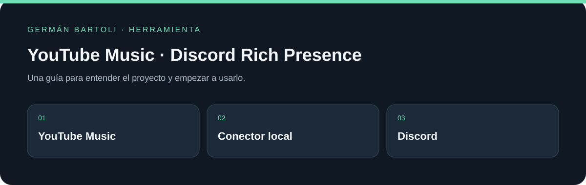

# YouTube Music · Discord Rich Presence

**Mostrá lo que escuchás en YouTube Music en Discord de escritorio mediante una extensión de Chrome y un conector local.**

[](https://github.com/GermanBartoli/Discord-Rich-Presence)
[](https://github.com/GermanBartoli/Discord-Rich-Presence/actions/workflows/validar.yml)

[Descargas](https://github.com/GermanBartoli/Discord-Rich-Presence/releases) · [Empezar](#primeros-pasos) · [Mapa del repositorio](#mapa-del-repositorio) · [Autoría](#autoría-de-esta-documentación)



*Esquema de orientación; no representa una captura de la aplicación.*

## Primeros pasos

1. Instalá la extensión y el conector Windows siguiendo los pasos de Instalación.
2. Abrí Discord de escritorio y reproducí música en YouTube Music.
3. Revisá la conexión desde el botón de la extensión y elegí cómo mostrar la canción y los ajustes de privacidad.

## Referencia y detalles

Extensión de Chrome Manifest V3 que muestra en Discord de escritorio la canción o sección abierta en YouTube Music. Incluye un interruptor para activar o desactivar la actividad y conserva los ajustes de privacidad, carátula, tiempo, pausa, navegación, botones y enlaces. Proyecto independiente de Google, YouTube y Discord.

## Instalación en Windows

1. Descomprimí el ZIP de la release en una carpeta permanente.
2. Abrí `chrome://extensions`, activá **Modo desarrollador** y elegí **Cargar descomprimida**. Seleccioná la carpeta `extension`.
3. Copiá el ID de 32 letras de la extensión que muestra Chrome.
4. En PowerShell, desde la carpeta descomprimida, ejecutá `powershell -ExecutionPolicy Bypass -File .\scripts\instalar-conector.ps1 -ExtensionId TU_ID`.
5. Abrí Discord de escritorio, reiniciá Chrome y reproducí una canción en `music.youtube.com`. El botón de la extensión muestra la conexión y permite desactivar la actividad.

El conector requiere Node.js 24 o posterior y .NET 9 instalados. Chrome se comunica con él mediante Native Messaging; el conector usa el IPC local de Discord. No requiere tokens ni contraseñas.

## Funcionamiento

En **Ajustes de YouTube Music → Mostrar en Discord** podés elegir entre **YouTube Music**, **Artista de la canción** o **Nombre de la canción** para el texto de actividad en la lista de miembros. La selección se guarda y se aplica al cambiarla. El modo privacidad oculta los datos de la canción.

La extensión observa únicamente `https://music.youtube.com/*`. Lee el título, artista, carátula, enlace y tiempo desde el reproductor. Detecta cambios del elemento de video y de los metadatos, incluso al pasar automáticamente a otra canción. Conserva el estado más reciente y separa los envíos a Discord al menos 4,1 segundos. Al desactivar la extensión o cerrar la última pestaña activa, limpia la actividad.

La carpeta [`source-premid`](source-premid) conserva el código original de la actividad adaptada. La versión ejecutable en Chrome está en [`extension`](extension). La lógica de lectura y sincronización se portó a JavaScript para funcionar sin PreMiD.

## Publicación en Chrome Web Store

El ZIP de `extension` es el paquete para subir a Chrome Web Store. El conector Windows se distribuye por separado en la release y se instala en el equipo. La ficha debe explicar ese requisito, declarar el acceso exclusivo a YouTube Music, enlazar la [política de privacidad](docs/privacidad.md) y mostrar capturas reales. Google decide la aceptación tras revisar el envío; una validación local no garantiza su aprobación.

## Desarrollo

```powershell
dotnet publish native/launcher/Launcher.csproj -c Release -o native/launcher/publish
node tests/host-smoke.mjs
node tests/content-smoke.mjs
node --check extension/background.js
node --check extension/youtube-music.js
```

La licencia y los créditos de la actividad derivada están en [LICENSE](LICENSE) y [THIRD_PARTY_NOTICES.md](THIRD_PARTY_NOTICES.md).

## Si Discord se abre después

El conector conserva la actividad y reintenta conectarse cuando Discord no estaba abierto. Si sigue sin aparecer, comprobá Discord de escritorio, el ID autorizado de la extensión y la instalación del conector; luego recargá YouTube Music. No hace falta introducir un token de Discord. La prueba `node tests/host-reconnect.mjs` cubre la reconexión simulada.


## Mapa del repositorio

- [native/launcher/Launcher.csproj](<native/launcher/Launcher.csproj>)
- [LICENSE](<LICENSE>)
- [native/launcher/Program.cs](<native/launcher/Program.cs>)
- [docs/privacidad.md](<docs/privacidad.md>)
- [docs/publicacion.md](<docs/publicacion.md>)

## Autoría de esta documentación

Repositorio mantenido por [Germán Bartoli](https://github.com/GermanBartoli). Guía revisada y actualizada con **Codex**, coautor de esta actualización documental. Los autores, colaboradores, licencias y recursos de terceros conservan sus créditos originales.

Los commits de esta revisión incluyen `Co-authored-by: Codex <noreply@openai.com>`; esta atribución no modifica la autoría del historial anterior.

<!-- firma-german-bartoli -->
<p align="center">
  <a href="https://germanbartoli.pages.dev/">
    <br />
    Hecho por Germán Bartoli · Ver portfolio
  </a>
</p>
